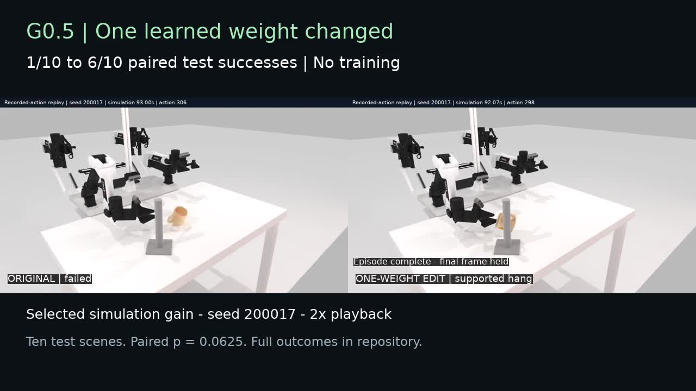

# G0.5 Weight-Space Programming

**One learned weight changed. No training. 1/10 → 6/10 supported mug hangs in ten paired simulation trials.**

A personal, independent experiment by [afinitus](https://github.com/afinitus). Not affiliated with or endorsed by Galaxea, RoboTwin, OpenAI, or an employer.

[](https://github.com/afinitus/g05-weight-space-programming/releases/download/v0.1.0/twitter_demo.mp4)

**[Download the 39-second demo](https://github.com/afinitus/g05-weight-space-programming/releases/download/v0.1.0/twitter_demo.mp4)** · [1× comparison](media/comparison_1x.mp4) · [Full report](REPORT.md) · [All paired outcomes](results/paired_episodes.csv) · [Twitter/X draft](social/TWITTER_DRAFT.md)

## Result

| Same ten held-out configurations | Original | One-weight edit |
|---|---:|---:|
| Supported hangs | 1/10 | 6/10 |
| Success rate | 10% | 60% |
| Learned scalars changed | 0 | 1 |

Five gains, no regressions; one scene succeeds in both conditions and four fail in both. All paired starting states and all three policy-camera images match exactly. Success requires one second of rack support after release, with no robot contact.

**Small pilot, not a reliability claim:** exact paired McNemar p = **0.0625**. This is ten held-out scenes, not 100. No physical robot was tested. The selected video shows one gain; all outcomes remain in the dataset.

## What changed?

```python
# G0.5 flow-matching action expert; a matrix coefficient, not an output bias.
model.action_expert.output_proj.weight[10, 168] += 0.2
```

The actual FP32 value changed from `0.06640625` to `0.26640623807907104`. Exactly **one of 2,859,995,988 learned scalars** changed. See the [reversible patch](patches/right_base_feature168_p0p20.json).

The original often lifted the mug but missed the rack during release. Forward-only probes identified an output feature that was stronger during rack approach than during regrasping. Editing its connection changed the right-arm base action more during approach. Other action dimensions also changed through flow integration and closed-loop feedback. We do **not** claim to have identified a semantic “hang the mug” neuron.

Six development scenes guided a bounded search of ten sparse candidates. The selected edit scored **6/6**, versus **1/6** original, and reproduced every saved action and physics sample in a confirmation run. We froze the edit before reviewing held-out outcomes. Two global action-offset controls scored **0/6** and **2/6** on development; they are limited controls, not an optimized calibration comparison.

## Model, simulator and physics limits

- Released **g05-robotwin20 flow-matching** checkpoint, not the paper’s autoregressive evaluation configuration.
- **ALOHA-AgileX**, native **RoboTwin Hanging Mug**, **SAPIEN** simulation.
- Original visual/state interface; no privileged object coordinates supplied to the policy.
- No fine-tuning, RL, backward passes, optimizer steps, or scripted replacement grasps.
- Physics recorded every 4 ms; scored videos recorded at fixed simulation time.

No final episode exceeded the development rack-contact audit threshold. That does not prove physical realism. Two failed edited trials still warrant caution: a 2.998 m/s robot-contact event and 8.49 mm penetration. Neither contributes to a gain. Native mug assets weigh 10 g. A candidate with a 7.4 m/s rack event was rejected during development. Read the [physics audit](results/final_physics_audit.json) and [full report](REPORT.md).

## Use this repository

- [Reproduce the statistics or run the policy](docs/REPRODUCING.md)
- [Explanation for the post and demo](docs/EXPLANATION.md)
- [Handoff for another coding agent](docs/AGENT_HANDOFF.md)
- [Every attempted candidate](results/candidate_ledger.json)
- [Frozen split and provenance](configs/)
- [Video provenance and playback details](media/README.md)

Model checkpoints, robot/object assets, credentials and private infrastructure configurations are **not** included. Obtain upstream dependencies under their respective terms. This repository includes original experiment scripts, sparse patches, measured per-episode outcomes, action/physics traces, plots and the selected demo.

Code is MIT-licensed; upstream model/software/assets retain their own licenses. See [LICENSE](LICENSE) and [third-party acknowledgments](docs/THIRD_PARTY.md).
